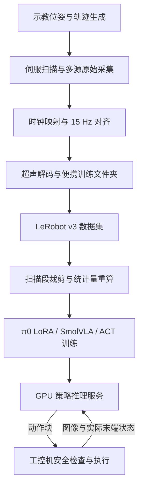

# 项目架构与代码导航

核对日期：2026-10-13。实现基线：`e8d95cc`。以下行为依据当前代码；历史实测另行注明。

## 1. 整体链路

训练数据采用固定 15 Hz 时间轴。TCP 指机械臂工具中心点，本项目以探头工具坐标对应的末端位姿表示机器人状态。状态和动作均为六维：`x, y, z, roll, pitch, yaw`，平移单位为 mm，旋转单位为度。状态来自实际 TCP 位姿；动作来自已下发的目标位姿。当前标签为绝对位姿，不是位姿增量。改变单位、维序或标签定义时，需要同步修改数据、归一化、训练及部署。

现有文档记载数据共 28 回合，原始训练版 49,053 帧，裁剪版 27,312 帧。该数量与现有训练日志的采样统计一致，但本次没有重新遍历全部数据文件。两路训练图像为 RGB（720×1280）和超声图像（256×256）；采集端保存深度信息，当前策略不使用深度输入。

## 2. 模块职责与代码导航

| 模块 | 输入与输出 | 核心代码 | 运行位置 |
|---|---|---|---|
| 示教与轨迹 | 示教位姿 → 拟合扫描轨迹 | `robot/my_code/collect_teach_points_any_count.py`、`generate_intermediate_trajectories.py`、`run_single_curve_from_latest_points_servo_soft_pose.py` | 工控机 |
| 同步采集 | 轨迹与设备数据 → 带时间戳的原始 episode | `robot/my_code/run_fitted_trajectory_vla_sync.py`、`collect_teach_vla_sync.py`、`realsense_sync_recorder.py` | 工控机 |
| 对齐与解码 | 原始 episode → 15 Hz 对齐样本与便携训练文件夹 | `robot/my_code/align_vla_episode.py`、`build_vla_training_dataset.py`、`export_ultrasound_images.py` | 工控机或具备解码资源的机器 |
| 数据集处理 | LeRobot 数据集 → 裁剪与重新统计的数据集 | `tools/trim_scan_segments.py`、`recompute_stats_local.py`、`verify_trim.py` | GPU 机器 |
| 策略训练 | 图像、状态、标签 → checkpoint | 根目录与 `pi0_ultrasound_lora/` 下的训练脚本 | GPU 机器 |
| 推理服务 | 观测 → 带时序信息的动作块 | `pi0_ultrasound_lora/serve.py` | GPU 机器 |
| 传输与执行 | 动作块 → 经检查的伺服目标；实时数据 → 观测 | `pi0_ultrasound_lora/remote/remote_client.py`、`robot/real_robot/real_robot_client.py` | 工控机 |

`robot/realsense_collector/` 是独立 RGB-D 辅助工具，不替代三路采集主线。`plot_pred_vs_demo.py` 与 `measure_inference.py` 用于分析策略输出，评估产物和条件需另记。

## 3. 为什么训练与执行分开

项目硬件记录为 GPU 机器配备 RTX 3090 24 GB，工控机连接机械臂、相机和超声设备。两端通过观测和动作协议连接，避免要求工控机承担大模型推理。由此也引入网络延迟、动作队列和版本一致性问题，需要在推理服务及客户端分别处理。

训练策略通过模仿示范目标学习控制，但预测输出仍要经过执行约束。训练 loss 是数值拟合指标；硬件执行是否稳定，需要在独立数据和影子测试中验证。

## 4. 当前实现的边界

- 便携训练文件夹到 LeRobot v3 的完整转换入口尚未补齐。
- 当前轻量与真机客户端的策略握手固定为 π0。SmolVLA 与 ACT 的训练完成不等于已接入同一真机部署链路。
- 原始动作窗口包含接近段；数据裁剪是当前扫描训练方案的一部分。
- 部署输入角度与训练展开角度之间存在需要核查的口径差异，详见 [接口约定](05-数据与接口约定.md)。
- 当前客户端使用最新预测覆盖重叠动作，没有实现时间集成；独立评估与真机成功率尚未系统汇总。
