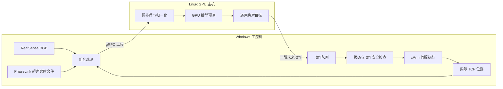

# 远程推理机制：从实时观测到机械臂动作

本文说明 2026-10-14 本地工作版本使用的远程推理流程，便于理解系统职责、动作队列和断供原因。相关训练与执行代码在本地仍有未提交改动；本文的文档提交不包含这些代码，不能将当前仓库 HEAD 直接视为下述全部功能的可部署版本。技术细节接入现有 [推理与机器人执行](04-推理与机器人执行.md)，项目总入口为 [README](../README.md)。

## 1. 两端职责与整体数据流

Linux GPU 主机保存权重、加载模型并生成动作；Windows 工控机采集传感器、显示 RGB、检查动作并通过 xArm SDK 控制机械臂。模型权重不复制到工控机，测试文件与日志使用其数据盘，避免占用系统盘。



TCP 指机械臂末端工具坐标系。模型输入中的 state 是机器人实际反馈的 TCP 位姿，而不是上一条命令目标。

## 2. 采集与上传观测

当前 ACT/SmolVLA 真机路径的每次观测包含：

| 字段 | 内容 |
|---|---|
| RGB | RealSense 彩色图像，传输尺寸 1280×720 |
| 超声 | 从持续更新的 PhaseLink 文件解码，传输尺寸 256×256 |
| state | x、y、z、roll、pitch、yaw，单位 mm/degree |
| task | 任务文字 |
| 调度信息 | 观测时间戳、动作序号、必要时强制处理标志 |

力与力矩参与工控机安全检查，当前不作为模型输入。RGB 窗口显示相机原生数据，经独立进程显示缩放，不等待推理，也不改变模型图像。

客户端读取各源最新可用数据，默认要求图像年龄不超过 0.5 秒。这是软件侧取最新数据，不是硬件触发的严格同步；检查发生在采集时，无法保证经过网络传输后观测仍然新鲜。超声文件存在也不代表输入实时，必须检查最新包时间。

上行使用 gRPC（远程过程调用）、pickle 序列化和可选 gzip；本次测试启用 gzip。图像以数组上传，没有 JPEG/WebP 编码。观测 RPC 延迟包括序列化、压缩、传输及服务端接收确认等环节，不等于 GPU 推理耗时。

## 3. GPU 侧推理及相对动作还原

启动时客户端发送策略类型、服务端 checkpoint 路径、图像字段及动作段长度。服务端在客户端握手后加载模型，检查类型、权重文件、图像键与输出维度；端口能连接不等于权重已加载。

一次推理依次进行输入整理、checkpoint 预处理、GPU 模型计算、输出反归一化和目标还原。当前动作段长度为 50，每个动作是六维 TCP 目标。

E-06 使用观测参考相对动作，标签为：

```text
训练：delta[k] = action[t+k] - state[t]，k = 1…50
推理：target[k] = state[t] + predicted_delta[k]
```

角度标签使用周期最短差。整段预测以生成该段的同一个原始观测 state 为参考，归一化之前缓存参考，反归一化后加回。工控机收到的是绝对目标，不能再次加 state，不能逐步累加增量，也不能换成执行时的新 state。

ACT、旧 SmolVLA 绝对动作 checkpoint 不适用此还原规则；动作表示由 checkpoint 配套处理器决定。相对表示本身不解决网络延迟或闭环控制问题。

## 4. 三条线程与动作队列

工控机并行运行观测发送线程、动作接收线程和控制循环。上传放在独立线程中，避免上传 RPC 直接阻塞动作时钟；控制循环仍包含状态读取、安全检查和 SDK 调用，因此不具备硬实时保证。

观测队列容量为 1。`observation_pending` 在排队和上传期间置位，期间不会接受新观测请求，也不会用最新帧不断替换旧观测。

控制循环目标频率为 15 Hz。50 个动作覆盖约 3.33 秒；剩余队列比例不超过 0.9 时尝试预取，完整 50 步段约执行 5 步后便可请求，此时缓冲约 3 秒。真正需要比较的是请求时剩余缓冲与“新有效动作入队”耗时，不能只看平均 RPC 延迟。

接收端丢弃已执行序号，同序号采用新预测。目前使用新段的有效未来动作重建队列，并非保留所有旧段再无限追加；重叠段会影响实际补充数量。服务端会过滤重复步号或过于相似的观测；客户端在队列为空时可用 `must_go` 请求强制处理。这保证请求有机会被处理，不保证返回期限。

动作时间戳与序号辅助调度；当前没有完整的端到端观测年龄补偿、迟到段重规划或本地高频插值机制。E-06 标签从下一周期开始，而服务端时间标记沿用现有段调度逻辑，时序精确对齐仍需进一步核对。

## 5. 检查、影子模式与实际执行

模型产生候选目标，工控机决定是否允许下发。影子模式采集真实输入并检查预测，不发运动目标；实际模式通过首动作预检后使能笛卡尔伺服，运行中持续检查。程序不自动移至训练起点，也不在结束后自动回起点。

| 检查 | D-22 实际设置 |
|---|---:|
| 目标距实际 TCP | 25 mm / 5° |
| 相邻目标跳变，首步相对实际 TCP | 3 mm / 2° |
| 力 / 力矩 | 40 N / 5 Nm |
| 图像最大年龄 | 0.5 秒 |
| 动作队列空置停止 | 3 秒 |
| 最长执行时间 | 100 秒 |

3 mm 是下发目标跳变限制，不是实际速度保证。可选目标限速器在 D-22 未启用；模型 15 Hz 目标尚未插值成更高频伺服轨迹。示教轨迹约束需另外提供安全轨迹文件，D-22 未配置。以上为测试参数，不代表接触扫描场景已完成全面安全验证。

## 6. 2026-10-14 实测：起步成功，随后断供

D-22 使用 E-06 20k 相对模型，先运行 30 秒影子测试，随后尝试最长 100 秒实际执行。以下来自本机取得的日志与停止后只读复查，完整摘要保留在本地待同步的部署记录。

| 项目 | 实测 |
|---|---:|
| 影子动作数 / 通过 / 拒绝 | 153 / 44 / 109 |
| 影子观测 RPC 平均 / 最大 | 9.164 / 35.423 秒 |
| 实际执行首目标距离 | 1.016 mm |
| 成功下发命令 | 50 条，SDK 返回码全部 0 |
| 首末命令下发跨度 | 3.276 秒 |
| 下发前最大目标与实际距离 | 1.489 mm |
| 实际 TCP 合位移 | 36.964 mm |
| 停止原因 | 动作队列空置 3.063 秒 |
| 停止后状态 | state 5、mode 0，错误/告警均为 0 |

下发前距离不是动作完成后的稳态跟踪误差。影子中机器人静止，未来目标的距离和段切换检查可能拒绝；不能直接将拒绝数当作闭环预测失败数。

本次执行的时间关系为：

```text
50 条动作到达 → 约 3.28 秒执行完 → 下一段未及时到达
                                      ↓
                              队列空置 3.06 秒
                                      ↓
                                  保护停止
```

实际循环未完成 100 秒。第一段起步及执行通过，但没有扫描质量或任务成功率结论。影子 RPC 明显长于动作覆盖窗口，提示供给速度不足；实际执行尚无完整分段耗时，不能将原因全部归于网络、压缩、模型推理或服务端过滤。

## 7. 后续改进顺序

1. 测量采集、序列化、压缩、上传、服务端等待、GPU 推理、回传及有效动作入队耗时，并记录队列水位和观测到执行年龄。
2. 在输入回归验证后减少图像传输量，评估合理缩放及图像编码；不能仅因模型内部 resize 就擅自改变训练输入口径。
3. 改善预取、迟到动作和队列重叠处理，确认相对参考及下一周期标签的时序一致性。
4. 设计本地高频轨迹插值与限速，明确停供时的停止及恢复流程，再进行影子和有限执行验证。

延长空队列等待只能容许停顿，不能让扫描连续；相对动作训练也不能替代链路和控制机制的完善。

## 8. 当前代码位置

- `robot/real_robot/real_robot_client.py`：实时采集、显示、健康与目标检查、xArm 执行。
- `pi0_ultrasound_lora/remote/remote_client.py`：协议、观测上传、动作接收与队列处理。
- `pi0_ultrasound_lora/serve.py`：模型加载检查、GPU 服务和下行动作格式。
- LeRobot `async_inference/policy_server.py`：观测过滤、预测与动作时间标记。
- `tools/train_smolvla_relative.py`：E-06 相对动作训练入口，本地新增、未随本文提交。
