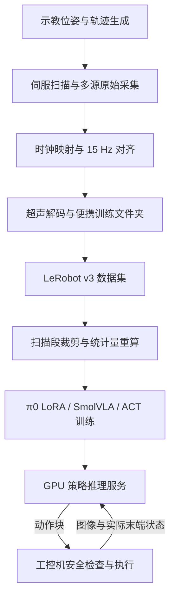

# xArm6 超声扫描项目开发记录

首次整理日期：2026-10-13。代码基线：`e8d95cc`。本记录根据仓库代码、本机 checkpoint 配置与训练日志整理，作为后续开发周期的持续记录入口。

## 1. 项目目标与记录范围

本项目研究如何利用示范数据训练机器人策略，使 xArm6 携带超声探头沿既定表面完成扫描。策略的输入包括外部 RGB 图像、超声图像和机械臂末端状态，输出为连续的末端目标位姿。训练与推理位于 GPU 机器；采集和运动执行位于 Windows 工控机。

VLA 指视觉、语言与动作模型。本项目使用 π0 和 SmolVLA 进行微调，并使用 ACT 作为对照。ACT 不含语言分支；各模型是否实际依赖图像或语言，应通过对照实验验证，不能仅由模型类别判断。

记录分为三部分：当前技术方案、具有复用价值的问题、训练实验与开发过程。证据采用以下口径：

| 类型 | 含义 |
|---|---|
| 代码核对 | 已查看当前实现或保存的配置，可确认程序行为或参数 |
| 日志核对 | 可由本机原始日志确认运行进度和数值 |
| 历史记录 | 来源为已有文档，本次没有重新执行对应实验 |
| 待核实 / 未测量 | 缺少充分证据，不能作为已验证结论 |

本机执行目录以 `<training-root>` 表示，数据目录以 `<dataset-root>` 表示，避免将真实部署路径带入仓库。首批配置摘要存放于 [training/](training/)，其中包含来源文件的 SHA-256，便于核对版本。当前未读取工控机原件，因此对工控机代码的说明限于本仓库副本；也未确认 GitHub 是否存在更新。

## 2. 当前技术方案

### 2.1 整体链路与数据约定



训练数据采用固定 15 Hz 时间轴。状态和动作均为六维：`x, y, z, roll, pitch, yaw`，平移单位为 mm，旋转单位为度。状态来自实际 TCP 位姿；动作来自已下发的目标位姿。当前标签为绝对位姿，不是位姿增量。改变单位、维序或标签定义时，需要同步修改数据、归一化、训练及部署。

现有文档记载数据共 28 回合，原始训练版 49,053 帧，裁剪版 27,312 帧。该数量与现有训练日志的采样统计一致，但本次没有重新遍历全部数据文件。两路训练图像为 RGB（720×1280）和超声图像（256×256）；采集端保存深度信息，当前策略不使用深度输入。

### 2.2 示教、轨迹与同步采集

**目的。** 生成可重复的扫描示范，同时保留原始状态、指令和传感器数据，使后续能够检查同步误差和标签质量。

**实现。** `robot/my_code/collect_teach_points_any_count.py` 记录示教 TCP 位姿；`generate_intermediate_trajectories.py` 生成中间轨迹；`run_single_curve_from_latest_points_servo_soft_pose.py` 提供曲线构建与伺服参数；`run_fitted_trajectory_vla_sync.py` 复用这些参数，协调运动和数据采集。

伺服周期为 0.02 s，即 50 Hz。运动循环按单调时钟的绝对期限调度，避免将每次计算和等待开销累计到下一周期。状态与动作日志通过队列交给写盘线程，减少文件操作对伺服循环的影响。这种调度减少累计漂移，但不构成硬实时保证。

| 数据源 | 保存方式 | 时间依据 |
|---|---|---|
| xArm 实际状态 | SDK 上报回调，写入 `robot_records.jsonl` | 回调时的主机时间 |
| 下发目标 | 记录指令、返回码与下发时间，写入 `robot_actions.jsonl` | 主机时间 |
| RealSense | RGB-D 帧及 `realsense_frames.jsonl` | 设备毫秒时间与主机时间 |
| PhaseLink 超声 | 厂商程序保存二进制原始包及帧索引 | 设备计数与主机时间 |

开始运动前，程序检查超声原始包是否已经产生。采集元数据保存窗口起止、帧数、队列丢帧等信息。原始采集窗口包含接近动作和扫描动作，因此“位于采集窗口内”并不等于“属于适合扫描策略训练的片段”。

### 2.3 时间对齐与样本筛选

**实现入口。** `robot/my_code/align_vla_episode.py`。该程序首先求各路数据与采集窗口的有效交集，再生成 15 Hz 样本时间点。

RealSense 和超声设备时间通过线性拟合映射至主机时间：`主机相对时间 = a × 设备相对时间 + b`。拟合使用相对时间，减小大数计算造成的精度损失。有效时间对少于 10 个，或拟合斜率超出 `[0.95, 1.05]` 时，不采用该设备映射。拟合残差会记录用于诊断，但当前代码没有以残差阈值直接拒绝拟合。主机到达时间受传输延迟影响，不能将此映射理解为已消除全部同步误差。

| 内容 | 取值方法 | 原因 |
|---|---|---|
| 实际 TCP 状态 | 两个状态之间插值；姿态采用最短角度差 | 状态随运动连续变化，避免 179° 与 −179° 插值错误 |
| RGB 与超声图像 | 取最近时间的真实帧 | 保留实际观测，避免合成图像 |
| 动作标签 | 取样本时刻之前最近的已下发指令 | 表示当时生效的控制目标 |

下发失败的动作被判为无效；伺服指令受时间偏差限制，位置目标按持续生效处理。默认偏差阈值为状态 80 ms、RealSense 50 ms、超声 50 ms、伺服动作 80 ms。样本的有效性写入 `quality.valid`，供建集阶段过滤。

### 2.4 超声解码、建集与数据处理

`robot/my_code/build_vla_training_dataset.py` 只接收有效且必需模态完整的样本；`export_ultrasound_images.py` 根据元数据解码原始超声包并生成图像。建集程序产出可携带的训练文件夹，**它本身不是 LeRobot v3 数据集**。当前仓库缺少可明确核对的“便携文件夹 → LeRobot v3”完整转换入口，后续需补录转换脚本、命令、版本及验证结果，以闭合复现链路。

GPU 侧数据处理包括：

1. `tools/trim_scan_segments.py` 根据实际状态与指令的平移、姿态偏差识别接近段。裁剪边界综合窗口内异常比例、后续有效比例和较大位置偏差的结束点；代码默认异常比例容许值为 0.2，并限制单回合最多裁去 85%。触及上限不代表剩余段已合格，必须查看报告。
2. `--unwrap-roll` 将每回合 roll 解开 ±180° 跳变，再按 360° 的整数倍对齐各回合的角度表示。该操作调整数值表达，不改变物理姿态。
3. 工具重排样本索引及时间元数据，复用原视频，避免重新编码。视频偏移元数据必须与新样本一致。
4. `tools/recompute_stats_local.py` 以 donor 统计量作为基础，重算可计算的数值特征和元数据统计；`tools/verify_trim.py` 检查裁剪后的索引、位姿、视频映射及统计量完整性。

注意：复用视频能够证明图像内容没有重新编码，**不能证明裁剪前后保留帧的图像统计分布相同**。沿用 donor 图像统计是当前实现的选择，是否适合各模型的归一化，需要另行核查。

### 2.5 模型训练

π0 通过低秩适配器（LoRA）更新部分参数，减少训练显存需求；SmolVLA 使用冻结视觉语言主干、训练动作专家及投影层的方式；ACT 使用新建策略及 ImageNet 预训练 ResNet18 视觉骨干。各模型均输出 50 步动作块。以 15 Hz 执行时，一个完整动作块覆盖约 3.33 s，控制设计必须同时考虑推理延迟与执行期间观测的变化。

π0 的图像键需映射至其底座约定的相机槽位；SmolVLA 的脚本清空预训练特征声明，让数据集推导当前特征；ACT 直接由数据集推导特征。三条训练入口的特征设置不同，不宜互相复制。具体实验配置见第 4 节。

### 2.6 推理服务与网络传输

GPU 侧 `pi0_ultrasound_lora/serve.py` 继承 LeRobot 策略服务，主要补充两项行为：

- 检测 LoRA checkpoint，先加载原始底座，再使用 PEFT 加载适配器；检查模型中是否存在 `lora_B` 参数及是否全部为零。
- 客户端没有提供 `rename_map` 时，保留 checkpoint 中的映射配置，避免被空配置覆盖。

`lora_B` 非零检查能够发现缺失或未更新的适配器，但不能单独证明底座、版本和全部权重均正确，仍需记录底座 revision 并进行推理对照。

工控机传输层为 `pi0_ultrasound_lora/remote/remote_client.py`。它通过 gRPC 发送带时间和步号的观测，接收动作块。两个生成的 proto 文件和传输对象定义需与服务端兼容。发送线程、接收线程及动作队列分别管理观测请求、网络接收和执行。

当前路径在发送侧将两路图像缩为 224×224；主要传输体积下降来自图像尺寸缩小。gzip 为可选压缩。服务端的 `--wire numpy/torch` 控制下行动作的数据类型，不控制上行图像尺寸。

当需要强制新观测入队时，客户端设置 `must_go`；服务端据此跳过相关合理性检查。它不是周期心跳。重叠动作按 `latest_only` 处理，同一时间步采用新块中的结果，已执行的旧时间步被过滤。当前未进行时间集成，即没有将多个预测按权重合成为单个动作。

### 2.7 真机客户端与执行约束

`robot/real_robot/real_robot_client.py` 继承传输客户端，增加 RealSense、实时超声和 xArm 状态读取，以及动作检查和运动接口。默认影子模式仅记录策略输出；运动执行需要显式执行参数与确认字符串。`--validate-only` 用于本地依赖和配置检查，不连接设备。

每次下发前检查连接、控制器错误与警告、状态、力与力矩、跟踪误差及动作跳变。示教轨迹约束仅在提供 `--safety-trajectory` 时生效。可选速率限制器将远处目标变为逐步逼近的位姿；默认不开启。

| 检查项 | 当前默认值 | 适用范围 |
|---|---|---|
| 力 / 力矩上限 | 40 N / 5 Nm | 每次下发前检查 |
| 单步位置 / 姿态变化 | 3 mm / 2° | 相邻目标 |
| 跟踪误差 | 12 mm / 5° | 目标与实际 TCP |
| 轨迹管 | 15 mm / 8° | 必须提供安全轨迹 |
| 图像最大年龄 | 0.5 s | RealSense 与超声 |
| xArm 状态最大年龄 | 0.25 s | `snapshot()` 默认值，不受图像参数控制 |
| 单次运行时间 | 10 s | 控制循环 |
| 动作队列空超时 | 0，关闭 | 需显式配置才能启用 |

这些数值是代码默认配置，不代表已完成接触扫描场景的安全验证。空队列时程序不重放旧动作，但网络连接存活、发送接收均未报错时，仍可能长期没有新动作，因此不能把空队列超时关闭解释为不存在停供风险。

## 3. 有价值的问题与处理记录

以下历史现象依据旧文档整理，处理方法已对照现行代码；本次未重新运行原始实验。

| 编号 | 现象及影响 | 原因 | 当前处理与验证边界 |
|---|---|---|---|
| P-01 接近段标签 | 动作指向距离实际状态较远的目标，混入扫描训练 | 采集窗口包含分阶段接近；位置指令在完成前持续生效 | 按状态与动作偏差裁去接近段，查看 `trim_report.json`；历史记录为 49,053 → 27,312 帧。本次未重跑裁剪 |
| P-02 roll 跳变 | 实际小幅转动在数值上跨越 ±180°，放大标准差 | 周期角度直接用于普通均值方差归一化 | 逐回合解卷绕并统一分支，再重算统计量。旧记录给出 std 约 172 → 7.77°；需以具体数据版本确认 |
| P-03 统计量缺键 | 训练启动时报相机键 `KeyError` | 数值统计重算没有生成所需的图像统计条目 | 使用 donor 补充未重算条目，重新计算数值与元数据统计，并断言特征键完整。图像统计是否应重算仍需单独判断 |
| P-04 视频时间容差 | 部分长视频帧出现时间戳校验失败 | 历史排查指向解码路径的 float32 时间精度，超过默认 1e-4 s 容差 | 训练设置 `tolerance_s=1e-3`；历史裁剪版最大偏差约 3.052e-5 s。容差放宽后仍需验证采样帧正确，不能替代同步质量检查 |
| P-05 LoRA 加载路径 | 服务启动成功，但加载结果与训练预期不符 | 普通加载路径未正确处理仅保存适配器的 checkpoint | 明确底座与 PEFT 加载顺序，检查 `lora_B`；代码已核对。检查非零只能覆盖部分失败模式 |
| P-06 图像命名与映射 | 有映射配置仍出现图像键缺失 | 上游部分访问发生在预处理之前；空配置还可能覆盖 checkpoint 映射 | π0 发送侧使用对应策略键；服务端保留 checkpoint 映射。此命名规则应按模型确认，不能直接套用至 ACT/SmolVLA |
| P-07 连通但无新动作 | 已发送观测，动作接收停止 | 已预测步号、相似观测检查可能过滤请求；接收线程异常也会表现类似 | 空队列时按条件设置 `must_go`；线程异常写入错误字段及 traceback。两种原因应分别排查 |
| P-08 客户端副本分叉 | 测试与部署目录接口不同 | 两份 `remote_client.py` 独立修改 | 仓库统一为 `remote/` 一份，真机客户端依赖该版本。工控机测试目录是否已刷新，待读取远程原件确认 |
| P-09 环境依赖污染 | 安装其他框架后训练依赖失效 | 环境定位依赖当前激活状态 | 使用明确训练程序路径、独立环境及环境备份；历史记录参见 `docs/07-environment.md` |
| P-10 队列等待未退出 | 训练已结束，后续任务仍长时间等待 | 历史记录指出 `pgrep -f` 匹配了等待程序自身 | 后续使用精确进程身份或父进程保存的 PID 管理依赖；本次没有核对仓库外队列脚本的修复程度 |
| P-11 文档参数失真 | 读者误判可训练范围、步数与实验状态 | 用脚本说明代替保存配置，并将目标步数当作完成进度 | 本次以 checkpoint 配置和日志双重核对，详见第 4 节；建立实验快照和更新约定 |

历史来源：`docs/01` 至 `docs/07`、`docs/09` 和 `docs/10`。以后新增问题按 [记录模板](记录模板.md) 记录触发条件、定位证据、处理与验证。当前可学习的共同经验是：数据含义、权重内容和线程状态都需要主动校验，接口返回成功不足以证明链路正确。

## 4. 训练实验与实际配置

### 4.1 实验状态

下表为 2026-10-13 首次整理时的快照。训练状态以日志与数字 checkpoint 为准，`train_config.json.steps` 仅代表该次配置的目标步数。日志末尾没有结束标记时，不能仅凭日志断言进程仍在运行。

| 编号 | 模型与数据 | 已确认的进度 | batch | 耗时证据 | 显存证据 |
|---|---|---|---|---|---|
| E-01 | π0 LoRA，未裁剪展开 roll 数据 | 数字 checkpoint 012250；该配置 steps=12,250 | 8 | 未找到该轮原始训练日志，未核实 | 未核实训练峰值 |
| E-02 | π0 LoRA，裁剪扫描段 | 有 `run_train_scan.sh`；未找到 `run2_scan` checkpoint | 脚本计划 8 | 未测量 | 未测量 |
| E-03 | SmolVLA，短任务文本扫描段 | 20,000 步完成，日志有结束标记 | 32 | 训练环 3:10:14 | 日志峰值 7.91 GiB |
| E-04 | ACT，π0 版扫描段 | 20,000 步完成，日志有结束标记 | 24 | 训练环 3:03:02 | 日志峰值 17.47 GiB |
| E-05 | SmolVLA，π0 版任务文本扫描段 | 首次核对约 2,950 步；数字 checkpoint 002000，无结束标记 | 32 | 当时进度约 28 分钟，最终耗时待补 | 已记录峰值 7.91 GiB，非最终值 |

硬件依据为已有项目记录：单张 RTX 3090 24 GB。显存口径已核对 LeRobot 代码：`torch.cuda.max_memory_allocated() / 1024**3`。该值表示 PyTorch 分配内存峰值，不包含全部缓存和其他 GPU 占用；不能与 `nvidia-smi` 总占用混用。表中耗时取进度条训练环时间，含循环内保存开销，不包含全部模型加载和启动时间。

特别说明：E-05 的 `last` 恢复点包含 steps=20,000，但当时日志只运行至约 3,000 步。该配置不能作为完成证据。快照工具优先使用最大的数字 checkpoint，避免把旧的 `last` 配置当作最新实际进度。

本次写入 E-05 配置摘要时，日志已继续至 3,529 步、训练环累计 33:34。上表保留首次核对时的状态，机器可读摘要代表稍后的读取时刻；最终完成状态仍待补充。

### 4.2 训练哪些参数，冻结哪些参数

| 模型 | 初始化 | 可训练范围 | 冻结或不更新范围 |
|---|---|---|---|
| π0 LoRA | `lerobot/pi0_base`，revision `6e245399ad403ccf02b8112b73cfdc2633068f38` | 动作专家 self-attention 的 `q_proj`、`v_proj` LoRA；五个投影/时间模块按 `modules_to_save` 全量保存训练 | PEFT 下未选中的底座参数不更新，包括视觉语言主干 |
| SmolVLA | `lerobot/smolvla_base`，revision `c83c3163b8ca9b7e67c509fffd9121e66cb96205` | 动作专家及投影层；`train_state_proj=true`；日志可训练参数 99,880,992 | `train_expert_only=true` 冻结 VLM，`freeze_vision_encoder=true`；总参数 450,046,176 |
| ACT | 策略新建，ResNet18 使用 ImageNet 预训练骨干 | 当前日志总参数与可训练参数均为 51,571,590 | 无整块冻结配置；不能描述为所有权重均随机初始化 |

π0 五个模块为 `state_proj`、`action_in_proj`、`action_out_proj`、`action_time_mlp_in`、`action_time_mlp_out`。适配器配置为 `r=16`、`lora_alpha=16`、`lora_dropout=0`。r 表示低秩更新的维度；alpha 调节更新缩放。具体 target 正则和保存模块已导出至 E-01 摘要。

旧脚本中的“SmolVLA 全量微调”不准确。当前实验没有使用 LoRA，但仍冻结约 350M 参数，应称为“冻结主干的部分参数微调”。π0 配置中的普通冻结字段为 false，也不能据此认定全部底座参与训练；PEFT 会进一步控制可训练范围。

### 4.3 优化与运行参数

| 参数 | E-01 π0 | E-03 / E-05 SmolVLA | E-04 ACT |
|---|---|---|---|
| 优化器 | AdamW | AdamW | AdamW |
| 学习率 | 1e-4 | 1e-4 | 1e-5；骨干同为 1e-5 |
| betas | (0.9, 0.95) | (0.9, 0.95) | (0.9, 0.999) |
| eps | 1e-8 | 1e-8 | 1e-8 |
| weight decay | 0.01 | 1e-10 | 1e-4 |
| 梯度裁剪范数 | 1 | 10 | 10 |
| 学习率调度 | 余弦衰减，warmup 1,000，decay 30,000，目标下限 1e-5 | 余弦衰减，warmup 1,000，decay 30,000，目标下限 2.5e-6 | 无 scheduler |
| 权重精度 / AMP | bfloat16；use_amp=false | use_amp=true | use_amp=false |
| 梯度检查点 | true | 配置未启用该项 | 配置未启用该项 |
| chunk_size / n_action_steps | 50 / 50 | 50 / 50 | 50 / 50 |
| 数据加载 workers | 8 | 8 | 8 |
| 视频后端 / 时间容差 | PyAV / 1e-3 s | PyAV / 1e-3 s | PyAV / 1e-3 s |

实际 checkpoint 的完整精选配置见 `training/E-*.json`，包括 seed、归一化方式、数据集 ID、底座 revision、配置摘要和日志摘要。调度器的目标衰减步数不等于训练总步数，也不能直接据参数推算末步实际学习率；实际值应读日志。

E-02 脚本计划为 24,500 步、batch 8，每 500 步保存。E-01 旧脚本默认 batch 4、24,500 步，**实际 checkpoint 配置是 batch 8、12,250 步**。启动时覆盖参数、脚本后来修改或不同配置的来源，需要后续找到原始启动命令才能进一步解释。

### 4.4 已有结果与结论限制

| 实验 | 最后一次已核对的日志数值 | 可得结论 |
|---|---|---|
| E-03 | loss 0.002，更新耗时 0.538 s，lr 2.5e-6 | 本轮训练完成；只能说明训练目标拟合情况 |
| E-04 | loss 0.030，更新耗时 0.541 s，lr 1e-5 | 本轮训练完成；不能与不同损失定义的模型直接排名 |
| E-05 | 约 2,950 步 loss 0.011，更新耗时 0.544 s | 中间训练指标，不能作为最终结果 |

当前尚未汇总独立验证集指标、逐维位姿误差、超声图像质量指标或真机任务成功率。因此不能判断哪一模型更适合扫描，也不能由低训练 loss 推断模型具备足够的闭环控制能力。

E-03 与 E-05 的任务文本分别来自不同数据版本，原文档称主要差别为语言指令长度和措辞。这应视为待确认的对照设计：比较前须核对保留帧、位姿、归一化、数据顺序、seed 和评估样本是否一致，才能将效果差异归因于文本。

历史推理记录给出 π0 峰值约 8.44 GiB、推理约 350–358 ms。这些是推理结果，不能填入训练显存表；本次未重测，也未核对全部原始评估产物。

## 5. 开发周期的持续记录方法

记录跟随实际事件更新：开展任务时填写目标；修改完成时记录代码与验证；训练启动时登记实验，首个 checkpoint 后核对实际参数；训练结束或中断时补充进度、耗时和原因；评估后补充指标与结论。旧实验不因后续更新被覆盖，恢复训练另记恢复来源。

仓库根目录 [AGENTS.md](../AGENTS.md) 已加入维护约定，后续在本仓库工作的助手应同步记录实质性变化。这个约定在助手处理开发任务时生效，不会在会话结束后自行持续监控机器。无人值守采集需将日志及显存监测接入训练启动流程，当前尚未接入。

配置摘要可使用以下命令生成；该命令仅读取训练产物并写摘要，不启动训练或连接机械臂：

```bash
python3 tools/snapshot_training_record.py \
  --run <training-root>/smolvla_ultrasound_scan_20k \
  --log <training-root>/smolvla_ultrasound_scan_20k.log \
  --id E-03 --output records/training/E-03.json
```

工具只确认 checkpoint、配置与日志中出现的证据，不判断模型好坏，也不凭无结束标记断言运行中。日志采样显存可能遗漏尚未写出的最终峰值，实时日志摘要仅代表读取时刻。

### 2026-10-13：首次重建开发记录

- **目标**：建立可学习、可追溯的方案说明、问题记录与实验记录。
- **核对范围**：采集与对齐关键函数、建集过滤、裁剪边界、服务端加载、客户端约束、LeRobot 冻结实现、四组已存在实验的配置及三组训练日志。
- **主要订正**：SmolVLA 的实际训练范围；π0 实际参数与脚本默认值；配置目标步数与运行进度；显存测量口径；便携文件夹与 LeRobot 数据集之间的转换缺口；图像内容不变与统计分布相同的区别。
- **产物**：本记录、模板、实验摘要工具、初始实验快照及仓库更新约定。
- **验证范围**：四份摘要与原配置、日志核对一致；临时样例验证未结束与结束标记识别、进度和显存提取；文档链接与 `git diff --check` 通过。本次未重跑训练及硬件实验。

## 6. 下一阶段待补充事项

1. 补齐便携训练文件夹转换为 LeRobot v3 的入口与实际数据版本证据。
2. 找到 π0 首轮启动命令和训练日志，补充可训练参数数目、训练峰值显存、总耗时及恢复过程。
3. E-05 结束后更新训练快照与结果；E-02 在启动后登记实际配置，不能提前标为已完成。
4. 建立按回合划分的独立评估，分别报告平移误差、姿态误差和扫描任务指标；记录相同评估集上的模型对照。
5. 下次修改训练流程时补充启动配置存档、环境与代码版本、显存采样、起止时间，减少事后回忆。
6. 读取工控机部署代码时对照本仓库副本，明确相机输入、超声参数、传输层版本与执行配置差异。

这些事项为当前记录中已识别的缺口，不意味着本轮已实施对应代码修改。
